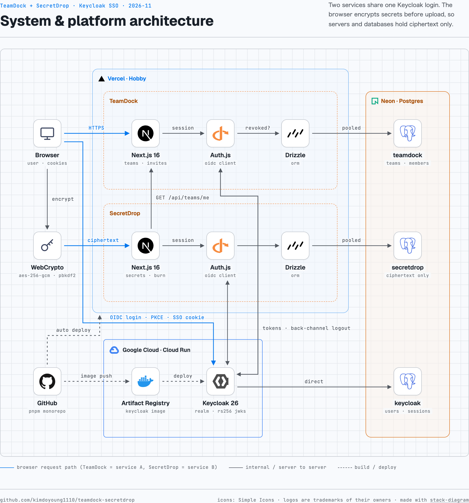

# TeamDock + SecretDrop

Keycloak SSO로 묶인 두 서비스. 팀플 비밀값을 카톡 대신 링크로 공유하고, 열면 사라지며, 서버도 내용을 볼 수 없다.

- **TeamDock** (`apps/teamdock`, 9000): 팀 워크스페이스
- **SecretDrop** (`apps/secretdrop`, 9001): 종단간 암호화(AES-256-GCM) 시크릿 공유
- **Keycloak** (8180): 두 서비스의 공통 로그인(SSO)

## 배포된 서비스

| 서비스 | 주소 | 플랫폼 |
|---|---|---|
| TeamDock | https://teamdock-sso.vercel.app | Vercel |
| SecretDrop | https://secretdrop-sso.vercel.app | Vercel |
| Keycloak | https://keycloak-936592447455.us-east1.run.app | Google Cloud Run |
| DB | Postgres 1개 인스턴스에 DB 3개 | Neon |

Keycloak은 요청이 없으면 0대로 줄어든다. 오랜만에 접속하면 첫 로그인 화면이 뜨는 데 수십 초 걸릴 수 있다.

## 아키텍처



한 장에 실행 구조와 배포 위치를 함께 그렸다. 상자는 어디서 돌아가는지(Vercel, Google Cloud, Neon)를, 선은 무엇이 오가는지를 나타낸다.

| 선 | 의미 |
|---|---|
| 파란 실선 | 브라우저를 거치는 흐름. 브라우저가 Keycloak에서 한 번 로그인하면 세션 쿠키가 남아, 두 서비스 모두 로그인 화면 없이 들어간다(SSO). SecretDrop으로는 WebCrypto가 암호화한 암호문만 올라간다. |
| 회색 실선 | 서비스 내부와 서버 간 통신. Auth.js가 Keycloak과 토큰을 교환하고, 로그아웃 시 Keycloak이 각 서비스에 Back-Channel Logout을 보낸다. SecretDrop은 `GET /api/teams/me`로 TeamDock에 팀 소속을 묻는다. |
| 점선 | 빌드와 배포. `main`에 push하면 Vercel이 두 앱을 배포하고, Keycloak은 이미지를 올려 Cloud Run에 배포한다. |

- TeamDock이 서비스 A, SecretDrop이 서비스 B다. 같은 레포를 Vercel 프로젝트 2개에 연결하고 Root Directory만 다르게 두었다.
- Keycloak은 상시 실행되는 컨테이너라 Vercel에 올릴 수 없어 Cloud Run에 올렸다.
- DB는 Neon 인스턴스 하나에 서비스별로 3개다. 서로의 DB에는 접근하지 않는다.
- 로컬은 docker compose로 같은 `realm-export.json`을 쓴다. 주소와 Client Secret만 환경변수로 달라진다.

그림은 [stack-diagram](https://github.com/caru-ini/stack-diagram)(오픈소스)의 템플릿으로 그렸다. 원본과 고치는 방법은 [docs/architecture/](docs/architecture)에 있다.

## 발표 자료

- [docs/presentation/TeamDock-SecretDrop.pptx](docs/presentation/TeamDock-SecretDrop.pptx) (PDF: [같은 폴더](docs/presentation/TeamDock-SecretDrop.pdf))
- [docs/verification.md](docs/verification.md): SSO 동작 검증 시나리오
- [docs/troubleshooting.md](docs/troubleshooting.md): 구현 중 겪은 문제와 해결

## 로컬 실행

필요한 것: Docker, Node 22, pnpm 9

```bash
pnpm infra:up          # Postgres(5433) + Keycloak(8180) 실행, realm 자동 import
pnpm infra:admin-http  # (선택) 관리자 콘솔이 "HTTPS required"로 막힐 때 한 번 실행
```

- Keycloak 관리자 콘솔: http://localhost:8180 (개발용 계정은 `infra/compose.dev.yml` 참고)
- realm `teamdock`에 클라이언트 `teamdock`, `secretdrop`과 테스트 사용자 2명이 `infra/keycloak/realm-export.json`에서 자동 생성된다.
- realm 설정을 고쳤으면 `pnpm infra:reset && pnpm infra:up`으로 다시 import한다.

### TeamDock (서비스 A)

```bash
pnpm install
cp apps/teamdock/.env.example apps/teamdock/.env.local   # AUTH_SECRET만 채운다: openssl rand -base64 32
pnpm --filter teamdock db:push                            # 테이블 생성
pnpm dev:teamdock                                         # http://localhost:9000
```

### SecretDrop (서비스 B)

```bash
cp apps/secretdrop/.env.example apps/secretdrop/.env.local   # AUTH_SECRET만 채운다
pnpm --filter secretdrop db:push
pnpm dev:secretdrop                                           # http://localhost:9001
```

두 앱을 모두 띄운 뒤 TeamDock에 로그인하고, 팀 화면의 "SecretDrop에서 시크릿 만들기"를 누르면 로그인 화면 없이 SecretDrop으로 넘어간다.

테스트 사용자는 alice, bob, carol 세 명이다(비밀번호는 `infra/keycloak/realm-export.json`). carol은 어느 팀에도 속하지 않아 팀 전용 시크릿의 권한 거부를 확인할 때 쓴다.

## 암호화 구조

```
[작성자 브라우저]                              [SecretDrop 서버 / DB]
링크 키 = 무작위 256비트
암호문 = AES-256-GCM(링크 키, iv, 평문)   ──▶  암호문, iv, (salt)만 저장
(선택) 비밀번호 → PBKDF2-SHA-256 60만 회
       → 그 키로 한 겹 더 AES-256-GCM
공유 링크 = /s/{id}#{링크 키}                   # 뒤는 서버로 전송되지 않는다

[열람자 브라우저]
"시크릿 열기" → 암호문 수신 → # 뒤 키로 복호화   서버는 암호문을 즉시 삭제(1회 열람)
```

- 암호화·복호화는 `apps/secretdrop/src/lib/crypto.ts`에서 WebCrypto API로만 한다.
- 서버가 받는 값은 `apps/secretdrop/src/lib/actions.ts`의 `createSecret` 입력이 전부다. 평문과 키는 없다.

## 배포 구성

```
브라우저 ──▶ teamdock-sso.vercel.app  (서비스 A) ──┐
        ──▶ secretdrop-sso.vercel.app (서비스 B) ──┼──▶ Neon Postgres
        ──▶ keycloak-….run.app        (Keycloak) ──┘
                     │  Back-Channel Logout (서버 → 서버)
                     └──▶ 두 앱의 /api/backchannel-logout
```

- **앱 2개**: 같은 레포를 Vercel 프로젝트 2개에 연결하고 Root Directory만 `apps/teamdock`, `apps/secretdrop`으로 다르게 둔다. `main`에 push하면 둘 다 자동 배포된다.
- **Keycloak**: `infra/keycloak/Dockerfile`로 만든 이미지를 Cloud Run에 올린다. realm 설정은 로컬과 같은 `realm-export.json`이고, 주소와 Client Secret은 환경변수(`TEAMDOCK_URL`, `TEAMDOCK_CLIENT_SECRET` 등)로 주입한다. 값이 없으면 로컬 개발용 기본값이 쓰인다.
- **과금 방지**: Cloud Run 최대 인스턴스 1, 최소 0. 결제 계정에 1,500원 예산 알림을 걸었다.
- 세 주소가 서로 다른 사이트라 앱 쿠키는 완전히 분리되고, 공유되는 것은 Keycloak 세션뿐이다.

### Keycloak 다시 배포하기

```bash
cd infra/keycloak
docker buildx build --platform linux/amd64 -t us-east1-docker.pkg.dev/<프로젝트>/keycloak/keycloak:<태그> --push .
gcloud run deploy keycloak --project <프로젝트> --region us-east1 --image us-east1-docker.pkg.dev/<프로젝트>/keycloak/keycloak:<태그>
```

realm이 이미 DB에 있으면 `--import-realm`은 건너뛴다. 운영 realm 설정을 바꾸려면 관리자 콘솔에서 고친다.
